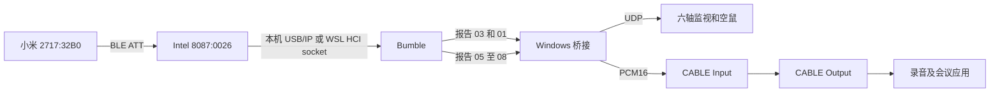

# 协议与实现

## 数据路径



两个后端使用同一套 GATT、运动、语音和配对逻辑。Windows 本机版从 `usbipd-win` 导入控制器后发送 USB/IP URB。HCI command 走 USB 控制端点 0，HCI event 走 interrupt IN `0x81`，ACL 走 bulk OUT `0x02` 和 bulk IN `0x82`。USB/IP 公共头与 URB 使用网络字节序，USB setup 包按 USB 约定为小端。程序关联 URB 序号并组包 HCI，连接关闭后由服务释放设备。 [USB/IP 协议](https://docs.kernel.org/usb/usbip_protocol.html) · [Bumble 文档](https://google.github.io/bumble/)

WSL2 版走 `hci-socket:0`。两种模式都使用 Bumble 作为蓝牙主机，以控制器的 public address 建连。本型号实测的配对为 Legacy BLE、Just Works、保留 bond。重连先用已保存的 LTK 建立加密，定向连接超时再扫描。主机未保存配对时才等配对广播。测试中更换 Bumble 的 USB 传输层时，同一物理控制器可用相同配对重连。

## HID 服务和报告引用

GATT HID 服务 UUID 为 `0x1812`。先验证 `0x2A4B` Report Map，再枚举 `0x2A4D` 特征并读取 `0x2908` Report Reference。Report Reference 的第一个字节是报告 ID，第二个字节标识 Input（1）、Output（2）或 Feature（3）。

| 报告引用 | 实测 ATT 值句柄 | 用途 |
|---|---|---|
| `01 01` | `0x0030` | 8 字节键盘输入 |
| `02 02` | `0x0034` | 键盘输出报告 |
| `03 01` | `0x0037` | 12 字节六轴输入，CCCD 为 `0x0039` |
| `04 03` | `0x003B` | 20 字节 Feature，控制体感和语音 |
| `05 03` | `0x003E` | 20 字节语音键与诊断消息 |
| `06 03` | `0x0041` | 20 字节语音负载 |
| `07 03` | `0x0044` | 20 字节语音负载 |
| `08 03` | `0x0047` | 20 字节语音负载 |

表中句柄用于解释抓包。程序靠 UUID 和 Report Reference 确认通道。仓库里的 [109 字节 Report Map](../mi-rc-2717-32b0-report-map.bin) 来自受测遥控器，仅把键盘与六轴声明给操作系统，私有 Feature 与音频并未声明在这份描述符里。这也解释了系统 HID API 为什么没有映射出完整功能。

键盘报告前两个字节为修饰键及保留位，剩余六字节容纳键值。本设备实测可按三组小端 16 位值解析。确认 `0x28`、返回 `0x65`、↑ `0x52`、↓ `0x51`、← `0x50`、→ `0x4F`、音量加 `0x80`、音量减 `0x81`。小房子或语音相关按键在键盘通道可见 `0x3E`，启动录音仍以报告 `05` 为准。电源与菜单缺少完整映射证据，当前不注入这些按键。

## 六轴

订阅报告 `03` 后，向报告 `04` 发送 ATT Write Request。GATT 值里无额外的 Report ID 首字节，以下均为 20 字节，省略部分补零。

| 阶段 | 前 6 字节 |
|---|---|
| 启用加速度计，保持陀螺仪关闭 | `01 00 00 80 01 02` |
| 等待约 4 秒，启用陀螺仪，保持加速度计当前状态 | `01 00 00 80 00 01` |
| 停止两组采样 | `01 00 00 80 02 02` |

控制字节 `0` 保持、`1` 启用、`2` 停用。两个启用顺序都在这台设备上验证过，启动器选用先加速度计。一次同时启用曾产生一个传感器三轴持续为零的报告，分步写入后同帧六轴都可随转动与倾斜变化。

12 字节体感值用 `struct.unpack('<6h', payload)`。顺序是 `ax ay az gx gy gz`，每个轴有符号 16 位小端，静置约 50 帧每秒。项目输出原始计数，物理单位比例和板内轴变换仍有待独立校准。空鼠用陀螺仪 X/Z 轴，静止时取中位数估计零偏，再应用死区、低通和小数像素累积。该控制是相对移动。

## 按住说话

报告 `05` 会发通知，首字节为按压状态，第二个字节为类型。只在第二个字节为 `0` 且第一字节为 `0` 或 `1` 时改变按键状态。实测 `00 03 …` 是语音诊断报告，不能按首字节把它当成松键。 [Dialog 语音遥控器手册的 Control Point Notifications 表](https://www.renesas.com/en/document/mat/um-b-086-da14585-voice-rcu-software-manual)

按下向报告 `04` 写入 `00 00 00 80 01` 加 15 个零，松开将第 5 字节设为 `00`。实测的语音报告 `05` 至 `08` 没有 CCCD，GATT 特征也未声明 Notify，但遥控器在配对连接内仍发送通知。Bumble 在本地为这些已验证的特征句柄登记回调。报告 `06`、`07`、`08` 通常循环传输，按到达顺序解码，约 400 个 20 字节包每秒。

音频为 Dialog IMA ADPCM，高半字节先于低半字节，每包恢复 40 个采样。预测值和步进索引跨包延续，每次按下重新初始化。Windows 端把音频转换成 16 kHz、单声道、有符号 PCM16，使用固定增益和限幅，再经 WASAPI 写入 VB-CABLE。输入缓冲有上限，空闲时输出静音。 [Dialog 语音与体感参考设计](https://www.renesas.com/en/document/whp/multi-functional-remote-controls-bluetooth-smart-controllers) · [VB-CABLE](https://vb-audio.com/Cable/)

## 本机数据接口

每个运动 UDP 数据报是一条 UTF-8 JSON。默认端口 `8765`，包装器和桥接窗口另用一个动态回环端口传状态及音量。以下只示意结构。

```json
{"type":"motion","utc":"2026-01-01T00:00:00.000+00:00","ax":0,"ay":0,"az":16384,"gx":0,"gy":0,"gz":0,"buttons":0}
```

窗口模式的 `buttons` 是按键位掩码，确认 1、返回 2、↑ 4、↓ 8。命令行默认仅发六轴。音频负载只经桥接内部进程流交给解码器，默认不进入 UDP 数据、终端、NDJSON 捕获文件或磁盘。
